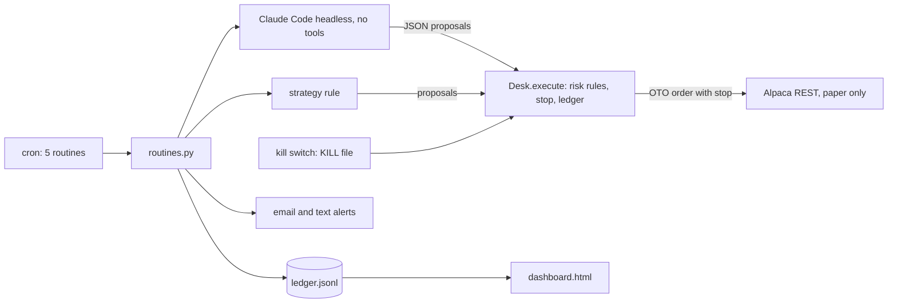

# ledgerbell

[](https://github.com/Exalt24/ledgerbell/actions/workflows/ci.yml)

Scheduled paper-trading routines for Alpaca with alerts, a dashboard and risk rules the code cannot skip.


*A replay of the real output of `python scripts/demo.py`, captured in [docs/demo-captured.txt](docs/demo-captured.txt). It runs against the local test server on made-up prices.*

In a full made-up trading day against a local test server, the bot opened three positions with stops, then the price tape was dropped 40 percent overnight. The daily loss limit tripped the kill switch, the next open was refused, and the account held no positions and no orders ([captured output](docs/demo-captured.txt), reproduce it with `python scripts/demo.py`).

## What it is and why it exists

Someone who wants an AI-assisted trading system starts with paper money, and the first thing that can go wrong is the bot, not the market. A model that suggests a 10,000 share order, a rerun that sends the same order twice, a crashed script with a stop that was never placed. ledgerbell is the small, boring part that makes those cases impossible to reach: one gateway every order passes through, five scheduled routines, and a log line for everything.

The owner sets the strategy. The example rule in `strategy.py` (buy above the 20 day average, sell below it) only shows where theirs plugs in and makes no claim about returns.

## What it does



| Routine | When (New York, weekdays) | What it does |
|---|---|---|
| premarket | 08:00 | Reads account, positions and daily bars, asks the model for a briefing and suggested orders, saves the day's plan, alerts |
| open | 09:35 | Runs the daily loss check, sends the plan and the rule's orders through the risk rules, audits stops, alerts |
| midday | 12:00 | Loss check, places any missing stop, warns on a position halfway to its stop |
| eod | 16:15 | Day recap with orders sent and refused, rewrites the dashboard, alerts |
| weekly | Friday 18:00 | Counts a week of ledger events, lists recent refusals, writes a report file, alerts |

The hard rules, all in `risk.py` as pure functions:

* Max position size: one symbol holds at most `max_position_pct` of equity, counting what is already held. An order that is too big is cut down, one with no room is refused.
* Max open positions, no short selling, and only symbols on the watchlist.
* Daily loss limit: equity down `daily_loss_limit_pct` against yesterday's close refuses new buys and flattens the account.
* Stop loss: every entry is an Alpaca OTO order, so the stop lives at the broker and survives this program crashing. The midday audit places a stop on any position that has none, and closes one that is already past it.
* Kill switch: a `KILL` file. Engaging it writes the file first, then cancels all orders and closes all positions, then alerts. Nothing trades until a person runs `ledgerbell unkill --yes`.
* Reruns are safe: order ids are built from the routine, the date, the symbol and the side, and `client_order_id` is documented as a unique identifier, so a second run of the same routine cannot place the order twice (the test server rejects a duplicate the same way).

Every order from the example rule or the model goes through `Desk.execute`, the only place an order endpoint is called.

## Options, more price feeds, text alerts and a run log

**Options leg** (off until `[options] enabled = true`). One shape of option order can leave the program: a single leg long call or put bought to open, with a premium cap (1 percent of equity, premium already held counted), an expiry window (7 to 45 days) and a stop on the premium (50 percent under the entry). A short or naked leg, a spread, a sell, a contract outside the window, a symbol off the watchlist and a second entry while a held contract has no stop are each refused with a named reason before the broker is called. Contracts come from `GET /v2/options/contracts` and prices, implied volatility and greeks from `GET /v1beta1/options/snapshots`; `ledgerbell options SPY` prints them. Alpaca's documentation lists only simple and multi-leg order classes for options, so there is no OTO stop: the stop is sent once the entry has filled, and the open and midday audits cover a contract that missed it. Rules, quotes and limits: [docs/OPTIONS.md](docs/OPTIONS.md).

**More market data providers.** `[market_data] provider = "finnhub"` takes each symbol's latest price from Finnhub's free `/quote` endpoint (key in `FINNHUB_API_KEY`, sent in the documented header) to size an order and place its stop. Finnhub lists daily candles as Premium and the free key answers 403, so the moving average still comes from Alpaca's bars and the ledger records the fallback.

`provider = "polygon"` does the same with Polygon, which renamed itself Massive in October 2025. The key is read from `POLYGON_API_KEY` and sent as `Authorization: Bearer`, so it never lands in a URL. A 429 or a 5xx is retried twice. The wait is the `Retry-After` Polygon names, or 12 seconds on the free plan's five calls a minute. Daily bars come from `/v2/aggs/ticker/{ticker}/range/1/day/{from}/{to}`, which the free plan includes, so the moving average comes from Polygon too. The price is the previous close from `/v2/aggs/ticker/{ticker}/prev`, because the last trade endpoint is not on the free plan. The default host is `api.massive.com`. Set `polygon_url` to `api.polygon.io` for the old host, which Polygon documents as serving the same API.

**Text message alerts.** Besides email and a chat webhook, `sms_to` and `sms_from` in `[alerts]` send each alert as a text through Twilio's Messages API. It uses HTTP basic auth and a form body with To, From and Body, cut to Twilio's 1,600 character limit. The account SID and auth token come from `TWILIO_ACCOUNT_SID` and `TWILIO_AUTH_TOKEN` in the environment when a text is sent. They are in no config file. A channel that fails, or has no credentials, is named in the alert problems list. It never stops a routine or the other channels.

**Airtable run log.** `[airtable] enabled = true` appends one row per routine run (routine, time, status, orders suggested, orders placed, orders refused) through Airtable's REST API; `python scripts/airtable_setup.py` makes the table. A failing log never fails a routine. Both are in [docs/INTEGRATIONS.md](docs/INTEGRATIONS.md).

**What ran for real** ([options only](docs/options-paper-run-captured.txt), [all together](docs/real-run-captured.txt)), on the paper account during market hours: 3804 active SPY contracts in the window and 516 calls within 3 percent of the price, each with a snapshot; one contract bought at 7.16 with its stop at 3.54 accepted as a gtc sell to close, a second contract refused by the premium cap, everything closed. Then the four routines with Finnhub and Airtable on: 7 AAPL, 4 MSFT and 2 AAPL calls sent, one more call refused by the cap, a real Finnhub quote for AAPL of 349.45, five rows written to Airtable and read back by id, then `kill` flattened the account. The real run also found a bug the stand-in had hidden: the midday scan called an option halfway to its stop at minus 7.4 percent, because it measured it against the share stop share. It now uses the option one, with a test.

## The model step

`agent.py` runs Claude Code headless (`claude -p --tools ""`, every tool off) on a prompt with the account and ten closes per symbol, and demands strict JSON. The reply is validated (symbols on the watchlist, whole share quantities, at most five orders), re-asked once with the exact validation error, and dropped if it is still wrong. Prices come from our bars, never from the model. The model can suggest an order and cannot place one.

[Captured run with the real model](docs/demo-captured-claude.txt): the briefing and the two suggested orders are real Claude Code output on the test server's made-up prices. The risk rules then cut the 15 share SPY suggestion to 9 to fit the size limit. The model is not deterministic, so another run suggests something else.

## Run it

You need Python 3.11 or newer. For the real thing, also a free Alpaca paper account and its trade only API keys. The test server needs no account.

```
python -m venv .venv
.venv\Scripts\activate          # Windows;  source .venv/bin/activate on Linux and macOS
pip install -e ".[dev]"
python scripts/demo.py
```

The last line runs a whole made-up day and prints it. For your own paper account (keys come from the Alpaca dashboard; `python scripts/paper_check.py` is a harmless first run that cancels what it places):

```
cp config.example.toml config.toml
export APCA_API_KEY_ID=...  APCA_API_SECRET_KEY=...
ledgerbell run premarket
ledgerbell status
```

`deploy/crontab` schedules all five routines on the New York clock. Other commands: `ledgerbell kill --reason "..."`, `ledgerbell unkill --yes`, `ledgerbell dashboard`, `ledgerbell options SPY` (contracts with greeks), `ledgerbell quote AAPL` (the configured provider's price) and `ledgerbell standin` to start the test server by itself. The options, Finnhub, Polygon, Twilio and Airtable settings are in `config.example.toml`, each off until switched on. The live endpoint is refused unless the config says `mode = "live"` and `live_confirmed = true`.

## Tests

```
python -m pytest              # 232 tests, about two minutes
python scripts/mutants.py     # removes one guard at a time in a temp copy
```

The tests drive the real client over HTTP against the test server, which is written from Alpaca's public documentation: orders with stops, a duplicate order id, a 401, paging through bars, stops firing on a moving tape, the loss limit tripping the kill switch, a broker that is down while the kill switch engages, alerts to a real local webhook, and the command line end to end. The options leg adds the same stand-in endpoints for contracts, snapshots and option orders (written from the documentation, rejecting what it calls invalid for options), and local stand-ins for Finnhub, Airtable, Polygon and Twilio. The Twilio one checks the basic auth header, the form body and the error JSON, and the Polygon one checks where the key is sent and answers a 429 on demand. The mutation run breaks 86 guards one at a time (each risk rule and each option rule, the exit stop, the kill file written first, the paper host check, the Finnhub and Polygon key handling and retry, the Twilio auth, form body and never-raise path, the Airtable wait and encoding, HTML escaping and more): 86 caught, 0 survived, 0 stale anchors ([output](docs/mutation-run-captured.txt), which keeps the first run where one survived and the test it led to).

## Run against a real Alpaca paper account

On a Monday evening with the market closed, `scripts/paper_check.py` and the routines ran against a real Alpaca paper account ([captured output](docs/paper-run-captured.txt)): account, clock and daily bars from the free IEX feed, a one share entry with an attached stop accepted as a queued OTO order, the same `client_order_id` refused a second time with a 422, cancel all and close all, then `premarket` with the real model on real prices, `open` skipping because the market was closed, and `eod`. That run found a bug the test server had hidden: Alpaca's bars `start` defaults to the beginning of today, so daily bars came back empty until the client sent a start date. The test server now behaves the same way and a test pins it.

## Limits

* Fills, the stops and the kill switch were seen on a real paper account for one session (2026-11-09). A stop firing at the broker and the daily loss limit on a real account are tested against the local test server only, and the 60 to 90 days of paper running the work is meant for have not been done.
* The test server fills market orders at its own price and fires stops at the next price it is given. It does not model slippage, partial fills, fees or the market calendar, and its option chain is made up: no implied volatility surface, assignment, exercise or early expiry.
* Shares are whole, long only, US stocks. Options are single long calls and puts bought to open, on Alpaca's free indicative feed whose quotes are modified (so the entry is a limit a few percent over the ask). No spreads, no short or covered legs, no exercise or assignment handling. Crypto is not covered.
* Finnhub's free plan has no candles, so it supplies prices and Alpaca still supplies the bars.
* The Polygon provider and the Twilio text alert have only been run against local stand-ins written from the vendors' documentation. Polygon's free plan allows five calls a minute and a routine makes about ten for a five symbol watchlist, so on that plan some calls get a 429, the routine falls back to Alpaca's bars and bar closes for them and the ledger says so.
* Market holidays are handled by asking Alpaca's clock, not by a calendar here.
* The email alert is tested over a real SMTP conversation with a small local mail server (no login or TLS); it has not been sent through a hosted mail provider. The webhook alert is tested over HTTP, and the text alert over HTTP against the Twilio stand-in.
* Nothing here is investment advice, and the example rule has not been backtested.

## Next

Backtesting and a Notion log are next. The run log goes to Airtable today.

## Stack

Python 3.11, requests, pytest, ruff, Alpaca's trading and market data REST APIs (options included), Finnhub, Polygon, Twilio, Airtable, Claude Code in headless print mode, plain cron.

## License

MIT, see [LICENSE](LICENSE).
