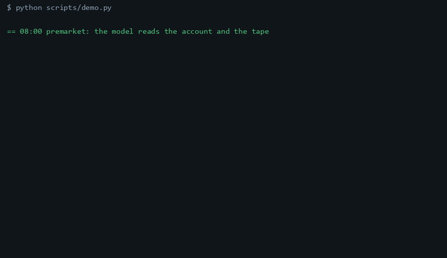
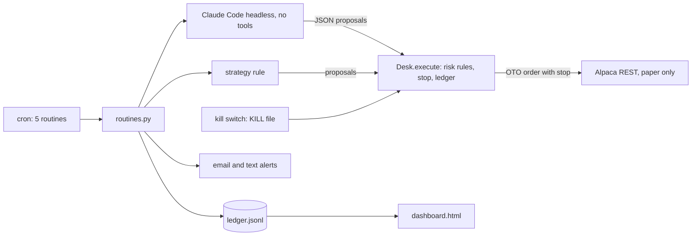

# ledgerbell

[](https://github.com/Exalt24/ledgerbell/actions/workflows/ci.yml)

Scheduled paper-trading routines for Alpaca with alerts, a dashboard and risk rules the code cannot skip.



*A replay of the real output of `python scripts/demo.py`, captured in [docs/demo-captured.txt](docs/demo-captured.txt). It runs against the local test server on made-up prices.*

In a full made-up trading day against a local test server, the bot opened three positions with stops, then the price tape was dropped 40 percent overnight. The daily loss limit tripped the kill switch, the next open was refused, and the account held no positions and no orders ([captured output](docs/demo-captured.txt), reproduce it with `python scripts/demo.py`).

## What it is and why it exists

Someone who wants an AI-assisted trading system starts with paper money, and the first thing that can go wrong is the bot, not the market. A model that suggests a 10,000 share order, a rerun that sends the same order twice, a crashed script with a stop that was never placed. ledgerbell is the small, boring part that makes those cases impossible to reach: one gateway every order passes through, five scheduled routines, and a log line for everything.

The owner sets the strategy. The example rule in `strategy.py` (buy above the 20 day average, sell below it) only shows where theirs plugs in and makes no claim about returns.

## What it does



| Routine | When (New York, weekdays) | What it does |
|---|---|---|
| premarket | 08:00 | Reads account, positions and daily bars, asks the model for a briefing and suggested orders, saves the day's plan, alerts |
| open | 09:35 | Runs the daily loss check, sends the plan and the rule's orders through the risk rules, audits stops, alerts |
| midday | 12:00 | Loss check, places any missing stop, warns on a position halfway to its stop |
| eod | 16:15 | Day recap with orders sent and refused, rewrites the dashboard, alerts |
| weekly | Friday 18:00 | Counts a week of ledger events, lists recent refusals, writes a report file, alerts |

The hard rules, all in `risk.py` as pure functions:

* Max position size: one symbol holds at most `max_position_pct` of equity, counting what is already held. An order that is too big is cut down, one with no room is refused.
* Max open positions, no short selling, and only symbols on the watchlist.
* Daily loss limit: equity down `daily_loss_limit_pct` against yesterday's close refuses new buys and flattens the account.
* Stop loss: every entry is an Alpaca OTO order, so the stop lives at the broker and survives this program crashing. The midday audit places a stop on any position that has none, and closes one that is already past it.
* Kill switch: a `KILL` file. Engaging it writes the file first, then cancels all orders and closes all positions, then alerts. Nothing trades until a person runs `ledgerbell unkill --yes`.
* Reruns are safe: order ids are built from the routine, the date, the symbol and the side, and `client_order_id` is documented as a unique identifier, so a second run of the same routine cannot place the order twice (the test server rejects a duplicate the same way).

Every order from the example rule or the model goes through `Desk.execute`, the only place an order endpoint is called.

## The model step

`agent.py` runs Claude Code headless (`claude -p --tools ""`, every tool off) on a prompt with the account and ten closes per symbol, and demands strict JSON. The reply is validated (symbols on the watchlist, whole share quantities, at most five orders), re-asked once with the exact validation error, and dropped if it is still wrong. Prices come from our bars, never from the model. The model can suggest an order and cannot place one.

[Captured run with the real model](docs/demo-captured-claude.txt): the briefing and the two suggested orders are real Claude Code output on the test server's made-up prices. The risk rules then cut the 15 share SPY suggestion to 9 to fit the size limit. The model is not deterministic, so another run suggests something else.

## Run it

You need Python 3.11 or newer. For the real thing, also a free Alpaca paper account and its trade only API keys. The test server needs no account.

```
python -m venv .venv
.venv\Scripts\activate          # Windows;  source .venv/bin/activate on Linux and macOS
pip install -e ".[dev]"
python scripts/demo.py
```

The last line runs a whole made-up day and prints it. For your own paper account (keys come from the Alpaca dashboard; `python scripts/paper_check.py` is a harmless first run that cancels what it places):

```
cp config.example.toml config.toml
export APCA_API_KEY_ID=...  APCA_API_SECRET_KEY=...
ledgerbell run premarket
ledgerbell status
```

`deploy/crontab` schedules all five routines on the New York clock. Other commands: `ledgerbell kill --reason "..."`, `ledgerbell unkill --yes`, `ledgerbell dashboard`, and `ledgerbell standin` to start the test server by itself. The live endpoint is refused unless the config says `mode = "live"` and `live_confirmed = true`.

## Tests

```
python -m pytest              # 103 tests, about 26 seconds
python scripts/mutants.py     # removes one guard at a time in a temp copy
```

The tests drive the real client over HTTP against the test server, which is written from Alpaca's public documentation: orders with stops, a duplicate order id, a 401, paging through bars, stops firing on a moving tape, the loss limit tripping the kill switch, a broker that is down while the kill switch engages, alerts to a real local webhook, and the command line end to end. The mutation run breaks 26 guards one at a time (each risk rule, the kill file written first, the paper host check, the kill blocking routines, yesterday's plan never replayed, HTML escaping and more): 26 caught, 0 survived, 0 stale anchors.

## Run against a real Alpaca paper account

On a Monday evening with the market closed, `scripts/paper_check.py` and the routines ran against a real Alpaca paper account ([captured output](docs/paper-run-captured.txt)): account, clock and daily bars from the free IEX feed, a one share entry with an attached stop accepted as a queued OTO order, the same `client_order_id` refused a second time with a 422, cancel all and close all, then `premarket` with the real model on real prices, `open` skipping because the market was closed, and `eod`. That run found a bug the test server had hidden: Alpaca's bars `start` defaults to the beginning of today, so daily bars came back empty until the client sent a start date. The test server now behaves the same way and a test pins it.

## Limits

* Nothing has traded in market hours yet. A fill, a stop firing at the broker, the kill switch closing live positions and the daily loss limit on a real account are tested against the local test server only, and the 60 to 90 days of paper running the work is meant for have not been done.
* The test server fills market orders at its own price and fires stops at the next price it is given. It does not model slippage, partial fills, fees or the market calendar.
* Whole shares only, long only, US stocks. Options and crypto are not covered.
* Market holidays are handled by asking Alpaca's clock, not by a calendar here.
* The email alert is tested with an injected sender, not a real mail server. The webhook alert is tested over HTTP.
* Nothing here is investment advice, and the example rule has not been backtested.

## Not done

Backtesting, a Notion or Airtable log, an options leg and a market data provider other than Alpaca's own feed.

## Stack

Python 3.11, requests, pytest, ruff, Claude Code in headless print mode, plain cron.

## License

MIT, see [LICENSE](LICENSE).
