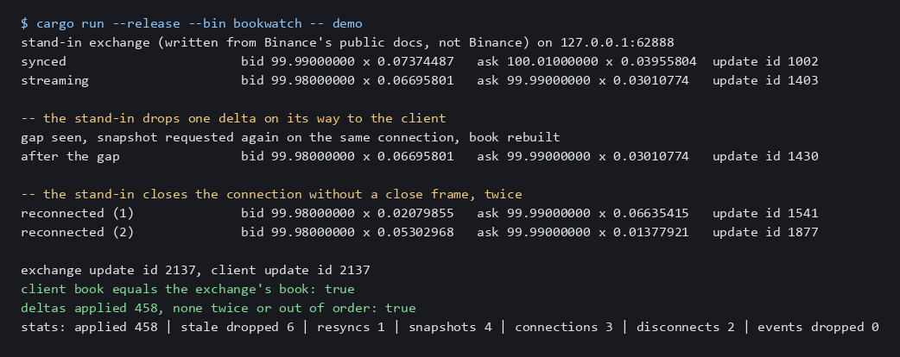

# bookwatch

[](https://github.com/Exalt24/ledgerbell/actions/workflows/rust.yml)

Two halves of a trading bot's worker, in Rust, each tested against stand ins.

The first is an async client that keeps a local order book from a websocket depth stream: a snapshot, then incremental deltas, with gap detection, a new snapshot on a gap, reconnects with backoff and a bounded channel for a slow consumer. The second is a small worker fleet: an Axum control server (a C2) that sends Protobuf commands over WebSockets, numbered with monotonic sequence ids, to bot workers. Each worker keeps its own state in SQLite in WAL mode, sizes an order with `delta_position`, guards it with a slippage ladder, a momentum filter, a fill stabilization window and a circuit breaker, signs it with EIP-712 and sends it to a stand in CLOB.

It lives in the ledgerbell repository because ledgerbell's Python bot sizes its orders against a price it fetches over REST, and this is the part that would watch a book and follow a leader instead. Nothing in the Python code imports it yet.



*The real output of `cargo run --release --bin bookwatch -- demo`, drawn into this image from the captured text in [docs/demo-captured.txt](docs/demo-captured.txt). The exchange in it is the local stand in described below. The fleet has its own captured run in [docs/fleet-demo-captured.txt](docs/fleet-demo-captured.txt).*

## What it was built and tested against

Two stand in servers, both written by me from public documentation, and one public test vector.

* The depth stream is a stand in exchange in [`src/standin.rs`](src/standin.rs), written from Binance's public documentation (the WebSocket Streams page and the WebSocket API page, loaded in Chromium on 2026-11-15; the lines it was written from are in [docs/feed-contract.md](docs/feed-contract.md)). It speaks the shape of Binance spot's `depthUpdate` stream and its `depth` snapshot request.
* The CLOB the worker sends orders to is a second stand in, in [`src/clob.rs`](src/clob.rs), written from Polymarket's public documentation (the Protocol V2 API migration, Builder Fees, Place Orders and Prices and Order Books pages and the CLOB OpenAPI file, loaded in Chromium on 2026-11-15; the lines used are quoted in [docs/clob-contract.md](docs/clob-contract.md)). It serves a book, takes a signed order on `POST /order` after recovering the signer from the signature, and reports a matched size that a test scripts.
* The EIP-712 code is checked against the public Mail example in the EIP-712 text and its Example.js: the type hash, the struct hash, the domain separator, the `\x19\x01` digest, the address and the signature all match the values the example states.
* Every other key in a test, the demo and the benchmarks is a random throwaway made when the process starts.

**It was never connected to a live exchange, never signed a real order, and never ran against money.** No request was ever sent to Binance or Polymarket, and neither stand in is either of them. The Polymarket documentation names the signed order's fields, their order, the domain and the REST routes, but not the Solidity type of each field, so a signature made by this crate is not claimed to be valid on the real exchange (see [docs/clob-contract.md](docs/clob-contract.md)).

Everything below was run over real sockets on loopback, and the process tests used real operating system processes, on one desktop: an AMD Ryzen 7 9800X3D (8 cores, 16 threads), 62 GB of memory, Windows 11 Pro, rustc 1.99.1.

## What it does

**The order book client**

* **The book** (`book.rs`). Prices and sizes are integers with eight decimals, so there is no float in it. A delta is refused, and the book left exactly as it was, when it is stale (already applied), when it skips an update id, when it overlaps the book's id after the first delta, when `first` is above `final`, or when it would leave the best bid at or above the best ask. A size of zero removes a level. It gives the best bid, the best ask, a depth limited view and the spread.
* **The client** (`client.rs`). One Tokio task owns the connection and the book. It follows the procedure on Binance's page: buffer the stream, take a snapshot, drop buffered deltas the snapshot covers, apply the rest. On a gap it throws the book away and asks for a new snapshot on the same connection; after five snapshots in a row that do not line up with the stream it drops the connection. On a closed or silent connection (no frame, not even a ping, for `idle_timeout`) it reconnects, waiting `base * 2^n` up to a cap, and goes through the same procedure, so no delta is applied twice and none is skipped. While it has no trustworthy book, `best_bid()` and `depth()` return `None` instead of a stale answer.
* **A slow consumer** (`client.rs`). Events go through a bounded `tokio::sync::mpsc` channel with `try_send`. When the channel is full the event is dropped and counted, the socket is never held up, and the book is unaffected, because it is read through the handle and not through the events. The next event that gets through carries `missed_before`, the number dropped since the last delivery.
* **`delta_position`** (`follow.rs`). Given a leader's position before and after, a ratio, a slippage cap in basis points and a book, it returns the follower order: side, the size the book can fill inside the cap, a limit price rounded so it never goes past the cap, the average fill and the slippage in basis points. Pure, no clock, no state.
* **The stand in exchange** (`standin.rs`). Keeps its own book (a plain `BTreeMap` that shares no code with `book.rs`), publishes deltas with ids that rise without a hole, answers snapshot requests, sends ping frames, and can be told to drop a connection with no close frame or with a close frame, silently drop the next delta, go quiet, refuse connections, answer a snapshot late, answer with a failure or with the wrong id, claim a stale update id, or send a frame the exchange would never send.

**The worker fleet**

* **The control server** (`c2.rs`, Axum). `GET /health`, `GET /status`, `GET /workers` (the registry: connected or not, connections, last acked command, orders sent, fills seen, outcomes, replays served), `GET /workers/{id}`, `POST /workers/{id}/commands` to add a command, and `GET /ws`, the WebSocket the workers use. Each worker has a command log in the C2's memory. The C2 sends a worker the commands after the id in its Hello, keeps at most a window of them unacknowledged, and sends them again from `after_seq + 1` when asked.
* **The wire** (`proto/fleet.proto`, `wire.rs`). Protobuf, compiled by `build.rs` with protox, a protobuf compiler written in Rust, so building needs no `protoc`. One `Envelope` per binary WebSocket frame, with a sequence id and one of `Hello`, `Heartbeat`, `PositionDelta` (the command), `Ack` and `ReplayRequest`. A command's id is its place in that worker's log (1, 2, 3 ...); a worker's own frames are numbered per connection, and the C2 counts any that arrive out of order.
* **Sequence ids** (`seq.rs`). One pure function: given the highest id handled and the id that arrived, the frame is the next one (apply it), at or below the last one (a duplicate, drop it), above the next one (a gap, ask for a replay after the last handled id) or zero (invalid). The worker asks once per hole and ignores later ids until the missing one comes.
* **The worker** (`worker.rs`). Connects, says Hello with its stored last acked id, and handles each command: read the book, check the breaker and the momentum filter, size the order under the ladder's cap, take a nonce and store the signed order in one transaction, `POST /order`, poll the order until the matched size has been stable for the window, store the result and move `last_acked` in one transaction, then send the Ack. A connection that drops is retried with a wait of `base * 2^n` up to a cap; after `failover_threshold` failures in a row on one address the next address in its list is tried. It does not switch back on its own.
* **The state** (`store.rs`, rusqlite with the bundled SQLite). WAL mode, checked by reading `PRAGMA journal_mode` back. Tables for the last acked id, one nonce counter per wallet, orders, fills and results. Taking a nonce and storing the order that uses it is one `BEGIN IMMEDIATE` transaction, so two connections to the same file never get the same nonce; a command's result and the move of `last_acked` are one transaction. An order is stored before it is sent, so a worker that dies after the exchange took the order and before it wrote that down sends the same signed bytes again on restart, and the CLOB stand in keeps one order. The default is `synchronous=NORMAL`, which survives a killed process; `--full-sync` asks for `FULL`.
* **Execution guards** (`guard.rs`, pure, time is a number of milliseconds passed in). A slippage ladder: a base cap in basis points, widened by a step per recent miss and by a thin book (resting size within reach under twice the wanted size), tightened by a step per recent clean fill and by a deep book (four times the wanted size or more), always inside a minimum and a maximum. A momentum filter: a buy is refused when the best ask is more than a threshold above the price the leader traded at, a sell when the best bid is below it, rounded up; a move in the follower's favour is never refused. A fill stabilizer: a matched size counts after it has stayed unchanged for a window, and any change restarts the window. A circuit breaker: closed, open after a number of failures in a row, half open after a cooldown with one probe allowed at a time, closed again by a good probe and reopened with a fresh cooldown by a bad one.
* **EIP-712 and the order** (`eip712.rs`, `clob.rs`). Typed data hashing from the EIP text (type hash, struct hash with nested structs, domain separator, the `\x19\x01` digest) with `sha3` for Keccak-256, and secp256k1 signing and signer recovery with `k256`, RFC 6979 nonces. The Polymarket shaped order has the documented fields in the documented order and the documented domain; amounts are in 6 decimals and rounded so the price they imply is never worse than the limit. The worker uses its per wallet counter as the order's `salt`.
* **The CLOB stand in** (`clob.rs`). `GET /book`, `POST /order` (it recovers the signer, refuses a wrong signature, an EOA order whose maker is not its signer and a second order from a maker with a salt that maker already used; the same signed order twice gets the same answer and is kept once), `GET /data/order/{id}` with a scripted matched size, a configurable answer delay and a switch that makes the next posts fail.

No `unsafe` (the crate forbids it). Dependencies: tokio, tokio-tungstenite, axum, prost, rusqlite, sha3, k256, getrandom, serde and serde_json, futures-util; criterion and proptest for tests; prost-build and protox to build.

## Run it

You need a recent stable Rust toolchain and a C compiler (SQLite is built from source).

```
cd rust
cargo test                                  # unit, property, integration and real process tests
cargo run --release --bin bookwatch -- demo       # the order book client against its stand in
cargo run --release --bin bookwatch -- fleet-demo # two C2s, a worker and a CLOB stand in, with real kills
cargo run --release --bin bookwatch -- c2 --listen 127.0.0.1:9100 --id A --generate 50
cargo run --release --bin bookwatch -- clob --port 9200
cargo run --release --bin bookwatch -- worker --id bot-1 --c2 ws://127.0.0.1:9100/ws --db bot.db --clob http://127.0.0.1:9200 --key-file bot.key
cargo bench                                 # criterion
python scripts/breakages.py                 # named deliberate breakages
```

`--key-file` makes a throwaway key there on first use and prints only its address.

## Tests

`cargo test` prints 125 unit tests, 51 integration tests (17 for the order book client, 31 for the fleet against its stand ins in one process, 3 that use real operating system processes) and 18 property tests, 194 tests with 0 failed. The three fleet test files were then run 20 times in a row: 20 runs, every one exit code 0.

* **Unit.** The book (a crossed delta is refused and the book is left untouched, a zero size removes a level, a stale or out of order delta is refused, a gap names the id it expected), `delta_position`, the frame parser, the backoff, the join of a snapshot with its buffered deltas. And for the fleet: sequence ids, each guard, the failover state machine, the Protobuf round trips, the SQLite store (WAL read back from the database, only the next command may finish, a resumed order spends no nonce, two connections on two threads never get the same nonce), EIP-712 against the public Mail example, the Polymarket shaped order and its amounts.
* **Property** (proptest, 512 cases each). The book against an independent `BTreeMap` model, and a follower order never going past its cap. For the fleet: exactly one verdict per sequence id; a receiver that applies the next id, drops repeats and asks for a replay at a hole ends with every id once and in order whatever holes and repeats it was sent; the ladder never leaves its bounds, more misses never tighten it, more fills never widen it, a deeper book never widens it; a move in the follower's favour is never refused by the momentum filter and a looser threshold accepts what a tighter one accepted; a fill is stable exactly when it has not changed for the window, checked against a model that works from the readings alone; the circuit breaker keeps its rules under any sequence of calls (no call let through before the cooldown, one probe at a time, failures below the threshold in the closed state); failover stays in range and its waits stay inside the limits; a signature recovers to its signer and to no other address; signing is deterministic; order amounts never imply a price worse than the limit.
* **Integration, one process.** The order book client against its stand in (a connection killed mid stream twice, a dropped delta, refused connections, a silent server, a slow consumer, garbage frames). The fleet: the C2's routes; a raw WebSocket client seeing Protobuf commands with rising sequence ids held back by a window; a worker applying 30 commands once and in order with every nonce used once; a hole in the sequence found and replayed once; a repeated frame dropped; the worker reconnecting when its C2 dies and comes back; failing over to a second address; giving up on a server that accepts and never speaks; stopping a worker task and starting another on the same database; the momentum filter skipping a buy after a run up; a fill that keeps changing not counting until it settles and one that never settles not counting at all; the ladder widening on a thin book and after misses and tightening after clean fills; the breaker opening after failed posts and closing after its cooldown through one probe; an order the exchange refuses being final and not retried; a post that fails twice being sent a third time with the same bytes; the CLOB stand in refusing a wrong signature, a maker that is not the signer and a reused salt.
* **Integration, real processes.** `fleet_process.rs` starts the `bookwatch` binary as C2s and workers. A worker process is killed with the operating system's kill after at least 15 commands and a new one on the same database finishes the rest of the 120. A worker process is made to exit (code 86) right after the CLOB stand in took the order for command 7 and before it wrote that down; the new process finds command 7's order stored as pending, posts the same bytes again, the stand in keeps one order for it (`posts` is 2 for it), and 30 commands end with 30 results, nonces 1 to the last with no hole and no repeat. A C2 process is killed with the worker connected to it; the worker fails over to the second C2 process and finishes all 120 commands. [docs/fleet-demo-captured.txt](docs/fleet-demo-captured.txt) is the same thing as a demo.
* **Mutation.** `cargo mutants` (27.1.0) on the whole crate, one run of about 21 minutes: 491 mutants, 239 caught, 250 that did not compile, 1 timeout and 1 missed. The timeout replaces `next += 1` with `next *= 1` in the worker loop, so the worker resends one command forever and the test run hangs until the time limit cuts it. The missed one replaces `>` with `>=` in the C2's idle timeout check; an elapsed time in nanoseconds is never exactly equal to the limit, so the two behave the same. Earlier runs left survivors and each one became a test, which is why the count of tests grew; the lists are in [docs/mutants-captured.txt](docs/mutants-captured.txt).

## Numbers

All on the machine named above, in release mode, loopback, the database on the C: drive. Printed as is in [docs/latency-captured.txt](docs/latency-captured.txt), [docs/bench-captured.txt](docs/bench-captured.txt) and [docs/bench-fleet-captured.txt](docs/bench-fleet-captured.txt).

**The fleet pieces**, `cargo bench --bench fleet`, criterion, one iteration is one operation (the middle number of each range):

| operation | time | about, per second |
|---|---|---|
| sequence id check (apply, duplicate or gap) | 4.9098 ns | 204 million |
| SQLite, store a command's result and move `last_acked` (WAL, `synchronous=NORMAL`) | 43.329 µs | 23,000 |
| SQLite, take a nonce and store an order in one transaction (same settings) | 68.885 µs | 14,500 |
| SQLite, a whole command: order, fill and result (same settings) | 209.01 µs | 4,800 |
| the same result write with `synchronous=FULL` | 3.2006 ms | 312 |
| the same nonce and order write with `synchronous=FULL` | 3.0594 ms | 327 |
| EIP-712: hash a Polymarket shaped order (domain separator, struct hash, digest) | 7.5100 µs | 133,000 |
| EIP-712: sign the 32 byte digest | 46.959 µs | 21,000 |
| EIP-712: hash and sign an order | 55.219 µs | 18,000 |
| EIP-712: recover the signer from a signature | 137.79 µs | 7,300 |

The write path is the SQLite one with the default flush: a commit that survives a killed process but not a power cut. With `FULL`, every commit waits for the disk and the rate falls by about 70 times on this drive. These are the costs of this code on this desktop, not a trading latency: a worker also waits for an HTTP round trip to the exchange and for the fill to settle.

**The order book client**, `cargo bench`, criterion, 10,000 deltas of four updates each on a book of 1,000 levels a side:

| | time for 10,000 deltas | throughput |
|---|---|---|
| `OrderBook::apply` | [1.9759 ms 2.0190 ms 2.0637 ms] | [4.8456 Melem/s 4.9530 Melem/s 5.0611 Melem/s] |
| parse the JSON frame, then apply | [16.250 ms 16.701 ms 17.153 ms] | [582.98 Kelem/s 598.78 Kelem/s 615.39 Kelem/s] |

`cargo run --release --example latency`, three runs, the time from the stand in handing a delta to its connections until the client's event shows the new best bid. 5,000 deltas, each one tick above the last best bid, one at a time:

| run | min | p50 | p90 | p99 | max | mean |
|---|---|---|---|---|---|---|
| 1 | 12.5µs | 24.3µs | 52.8µs | 72.3µs | 1.6897ms | 30.988µs |
| 2 | 12.6µs | 26.4µs | 53.3µs | 86.5µs | 175.6µs | 31.594µs |
| 3 | 10.5µs | 32.9µs | 56.8µs | 76.2µs | 1.0873ms | 36.371µs |

And the same 5,000 deltas sent as fast as the stand in can: 117,573, 112,662 and 107,781 deltas per second from the first send until the last delta is in the client's book, with no event dropped. The time includes serializing the frame, the loopback TCP hop, a websocket frame each way, JSON parsing, the book update and the event reaching the consumer task.

## Limits

* Only the stand ins have been used. The real update rates, the 24 hour connection limit, `serverShutdown` and rate limits of Binance, and everything about Polymarket's real matching, fees, API authentication, balances, allowances, tick sizes and settlement, are not exercised. The Data API client in the job post's stack, rebate structures and MEV or relayer behaviour are not built.
* The order's Solidity types are this crate's reading of a page that lists field names only, and `side` is encoded 0 and 1 on a guess. A signature from this crate is not claimed to be accepted by the real exchange. There is no nonce in the documented signed order; the counter is this crate's own design and becomes the `salt`.
* The command log lives in the C2's memory. A second C2 shows the same commands only because it is started with the same `--generate` count; there is no replication, no persistence on the C2 and no leader election. A C2 that restarts empty has nothing to send until commands are added again.
* A worker is a single task that handles one command at a time. The sequence checks, the resend and the SQLite writes are tested; throughput across many workers is not measured.
* A silent network partition is noticed only when the worker's ping gets no answer for `idle_timeout`; a C2 that closes the socket is noticed at once.
* `delta_position` reads one book and applies one cap. It does not model fees, partial fills over time, an order that rests, or the leader's own fills. The momentum filter compares the best price with the leader's trade price; it does not look at a window of the book's history.
* The HTTP client the worker uses is a few lines over a TCP socket and speaks plain `http://` only, because the only server it ever talks to is a stand in on loopback. It would need TLS and a real client for anything else.
* In the first order book part: one symbol per client, plain `ws://` on loopback, and one rule stricter than the page (a live delta that overlaps the book's id is treated as a gap, see [docs/feed-contract.md](docs/feed-contract.md)). A reconnect waits `base * 2^n` with no random jitter, which a fleet of clients would want.
* The numbers are loopback timings inside one process, or between processes on one desktop. They say how fast this code is. They say nothing about a network, an exchange, trading latency, co-location or running this against money.

## License

MIT, see [LICENSE](https://github.com/Exalt24/ledgerbell/blob/main/LICENSE).
